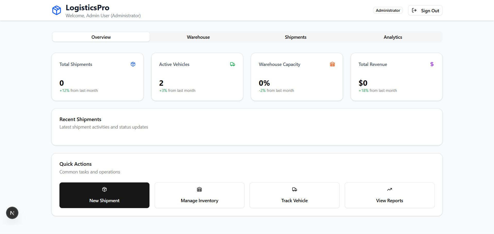
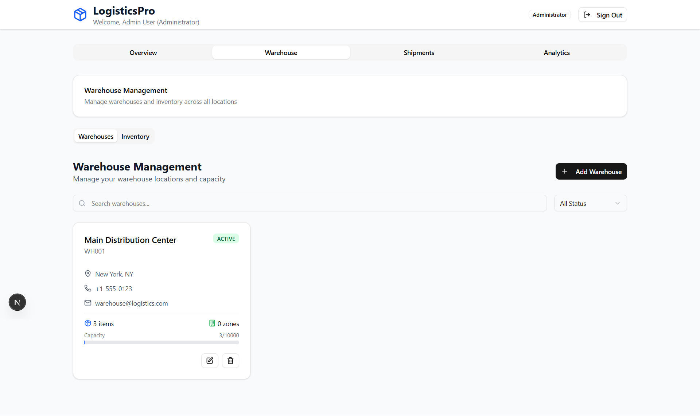
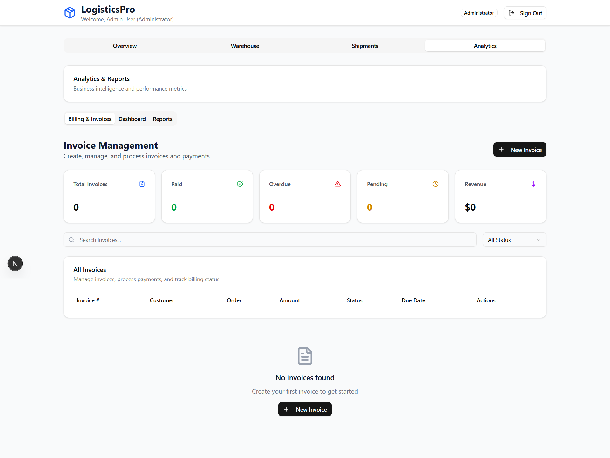
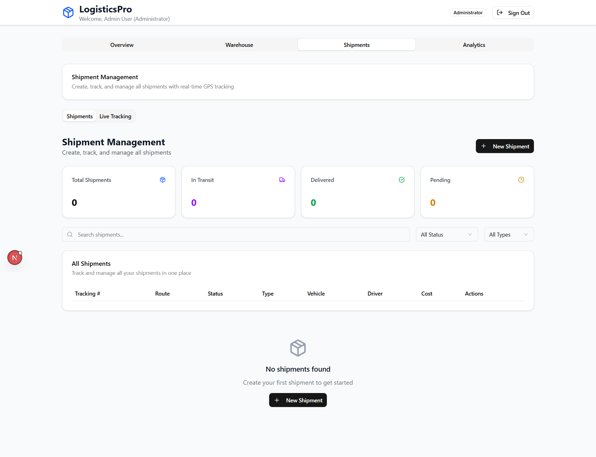
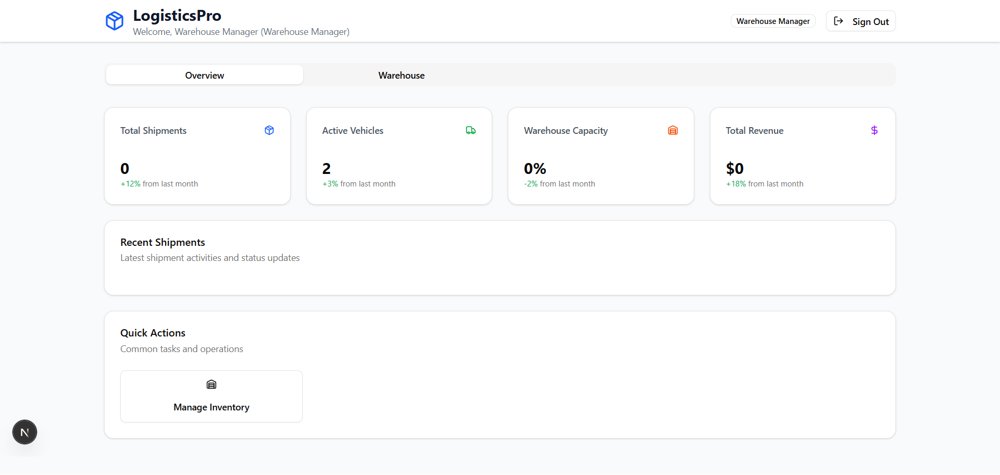
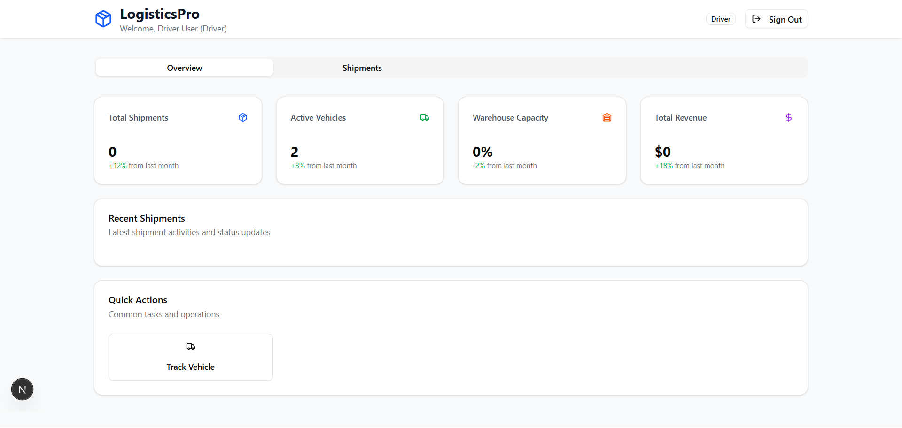
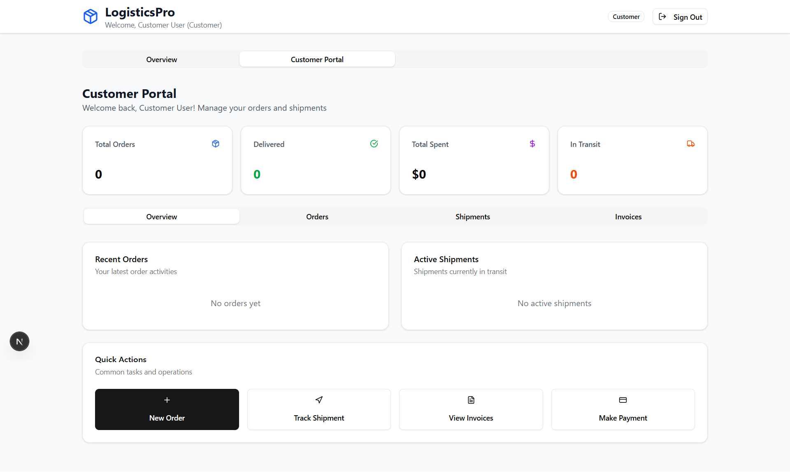

npm run db:seed

## Screenshot

## Features

- users
- warehouses
- warehouse zones
- inventory items
- vehicles
- orders
- shipments
- invoices
- maintenance records
- order items
- shipment items
- tracking entries
- payments
- reviews
